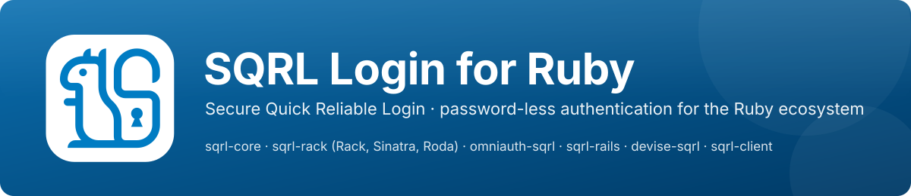

<p align="center">
  <a href="https://github.com/danielpclark/sqrl-ruby"></a>
</p>

<p align="center">
  <a href="https://github.com/danielpclark/sqrl-ruby/actions/workflows/ci.yml"></a>
  <a href="https://github.com/danielpclark/sqrl-ruby/actions/workflows/release.yml"></a>
  <a href="LICENSE"></a>
  
  
  <a href="https://github.com/danielpclark/sqrl-ruby/commits/main"></a>
  <a href="https://github.com/danielpclark/sqrl-ruby/issues"></a>
  <a href="https://rubocop.org"></a>
  <a href="https://www.grc.com/sqrl/sqrl.htm"></a>
</p>

# SQRL Login for Ruby

[SQRL](https://www.grc.com/sqrl/sqrl.htm) (Secure Quick Reliable Login) for the Ruby
ecosystem: a pure-Ruby protocol core, server-side integrations that give existing login
systems SQRL support with one gem and one line of configuration, and a bot-capable client
that logs in to SQRL-enabled websites from scripts and test suites.

| Gem | Version | Downloads | Require | Use it when | Quick start |
| --- | --- | --- | --- | --- | --- |
| [`sqrl-core`](gems/sqrl-core) | [](https://rubygems.org/gems/sqrl-core) | [](https://rubygems.org/gems/sqrl-core) | `require "sqrl/core"` (or `"sqrl"`) | you need the protocol, the cryptography or the identity formats directly | `SQRL::Session`, `SQRL::Server::Handler`, `SQRL::S4Identity` |
| [`sqrl-rack`](gems/sqrl-rack) | [](https://rubygems.org/gems/sqrl-rack) | [](https://rubygems.org/gems/sqrl-rack) | `require "sqrl/rack"` | Rack, Sinatra or Roda | `use SQRL::Rack::Middleware` / `register Sinatra::SQRL` / `plugin :sqrl` |
| [`omniauth-sqrl`](gems/omniauth-sqrl) | [](https://rubygems.org/gems/omniauth-sqrl) | [](https://rubygems.org/gems/omniauth-sqrl) | `require "omniauth/sqrl"` | you already use OmniAuth | `provider :sqrl` |
| [`sqrl-rails`](gems/sqrl-rails) | [](https://rubygems.org/gems/sqrl-rails) | [](https://rubygems.org/gems/sqrl-rails) | `require "sqrl/rails"` | Rails, including the Rails 8 `generate authentication` stack | `bin/rails generate sqrl:install` |
| [`devise-sqrl`](gems/devise-sqrl) | [](https://rubygems.org/gems/devise-sqrl) | [](https://rubygems.org/gems/devise-sqrl) | `require "devise/sqrl"` | Devise | `devise :sqrl_authenticatable` |
| [`sqrl-client`](gems/sqrl-client) | [](https://rubygems.org/gems/sqrl-client) | [](https://rubygems.org/gems/sqrl-client) | `require "sqrl/client"` | bots, automation, tests; checking a server's conformance | `SQRL::Client::Agent.new(identity:).login(url)` |

Names follow the RubyGems convention: the dash marks a gem that extends another library or
namespace and maps to the require path (`sqrl-rack` is `sqrl/rack`, `SQRL::Rack`). Bundler's
auto-require resolves each of them that way, so a plain `gem "..."` line is enough.

All six gems share one version and live in this repository. Per-framework guides are in
[docs/integrations](docs/integrations); the threat model and deployment checklist are in
[docs/security.md](docs/security.md) and the protocol summary in [docs/protocol.md](docs/protocol.md).

## What is implemented

- The complete SQRL client/server wire protocol (`query`, `ident`, `disable`, `enable`,
  `remove`, `ids`/`pids`/`urs` signatures, every TIF bit, `ask`/`btn`, `sin`/`ins`,
  previous identities and re-keying, the `x=` path extension, Alt-IDs, `can=`, Client
  Provided Session), following GRC's final specification and reproducing GRC's reference
  client request bodies byte for byte.
- EnScrypt, EnHash, the identity lock (SUK/VUK/URSK), S4 identity files (type 1, 2 and 3
  blocks), rescue codes and the base56 textual identity, verified against every published
  test vector. Everything is built on Ruby's bundled `openssl` gem; the core has no other
  runtime dependency.
- A server engine whose state sits behind nut, identity and pending-login store interfaces
  (in-memory, Redis, ActiveRecord and `ActiveSupport::Cache` implementations, all checked by
  one shared store-contract spec), with nut single use, IP matching, browser session
  binding, one-time CPS tokens, rate-limit and prune hooks and host allow-listing.
- Account policies surfaced to applications: `sqrlonly` refuses password login and
  `hardlock` refuses password recovery in the Rails 8 and Devise integrations, and users can
  list and unlink their SQRL identities.
- A browser script (`sqrl.js`) that performs the standard same-device probe on
  `localhost:25519`, polls for logins from another device and fetches a fresh code when one
  expires, plus server-side QR codes.
- A bot client with login-page discovery, a cookie-carrying transport, a Capybara helper, a
  command-line tool and a 23-case conformance suite.

## Using and testing with the SQRL browser extension

To log in to a site built with these gems from a desktop browser, install the **SQRL Login**
extension, a complete SQRL client written in Rust and compiled to WebAssembly, with
identities kept locally and the same-device handoff (Client Provided Session) built in:

- Chrome, Edge and Brave: [Chrome Web Store](https://chromewebstore.google.com/detail/fimbniikombkehgjnfoamijogcafnpff?utm_source=item-share-cb)
- Firefox: [Firefox Add-ons](https://addons.mozilla.org/en-US/firefox/addon/sqrl-login/)
- Source: [danielpclark/SQRL-extension](https://github.com/danielpclark/SQRL-extension)

Create an identity in the extension, open the login page of any of the
[example applications](examples) (each `bin/dev` explains how to serve it over HTTPS, which
real SQRL clients require), and click "Sign in with SQRL". The extension performs the
protocol and sends the tab straight to the logged-in page. The same extension works against
GRC's demo site, so you can compare behaviour with the reference implementation.

For automated testing without a browser, use [`sqrl-client`](gems/sqrl-client): it performs the
same logins from scripts and test suites and ships a conformance suite you can run against
your own server.

## Development

```sh
bundle install
bundle exec rake spec:gems          # every gem's specs
bundle exec rake spec:integration   # boots each example app over HTTPS and drives it with the bot client and a headless browser
bundle exec rspec spec/interop      # the conformance suite against the Rust reference server
bundle exec rubocop                 # lint (enforced in CI)
bundle exec rake build              # packages the six gems into pkg/; `rake release_check` lists them
```

Each application under [`examples/`](examples) is a complete, independently bundled
application of its framework (`bin/dev` starts it). Run `bundle install` inside each one
before the integration specs: they start every example on a free port with its own bundle
and run the conformance suite, bot flows and browser flows against it, twice (the second
time with `ask` and `sin` enabled).

What the suites need: a Chromium binary for the browser flows (`BROWSER_PATH`, or the
Playwright Chromium that CI installs), the Rust toolchain and a checkout of
`SQRL-extension` for the interop run (`SQRL_RUST_TEST_SERVER` points at the built
`sqrl-test-server`; the specs skip without it), and optionally a local `redis-server` for
the Redis store specs (they also run against an in-process double). `gemfiles/` holds the
Rails 7.1, 7.2 and 8.0 bundles that CI runs `sqrl-rails` and `devise-sqrl` against.
Deferred work and ideas are tracked as GitHub issues.

Ruby 3.1 or newer for `sqrl-core`, `sqrl-rack`, `omniauth-sqrl` and `sqrl-client`;
Ruby 3.2 or newer for `sqrl-rails` and `devise-sqrl`. One EnScrypt iteration takes about
45 ms with OpenSSL 3, so unlocking a real identity file takes a few seconds; tests use
ephemeral identities that skip EnScrypt.

## Credits and license

SQRL was designed by Steve Gibson of Gibson Research Corporation, who published the
specification, and the official logo used in the banner above, into the public domain
(<https://www.grc.com/sqrl/logo.htm>). The protocol and cryptography here are a port of the
Rust implementation in [SQRL-extension](https://github.com/danielpclark/SQRL-extension).

MIT License, Copyright (c) 2026 Daniel P. Clark. See [LICENSE](LICENSE).
